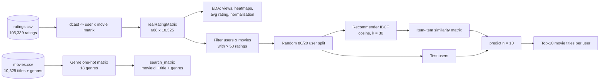

# Movie Recommendation System using R (Item-Based Collaborative Filtering)

> Recommending the top-10 movies for each user from 105K MovieLens ratings with recommenderlab's item-based collaborative filtering and cosine similarity.

    


## TL;DR

A **Netflix-style recommender** written in **R**. It learns from **105,339 ratings** (0.5-5 stars) that **668 users** gave to **10,325 movies** (MovieLens) which movies are *liked by the same people*, then recommends **10 new movies to each user**. It uses **Item-Based Collaborative Filtering (IBCF)** from the `recommenderlab` package with **cosine similarity** and keeps the **30 most similar movies** per film. The project also includes a genre matrix, rating-distribution charts, heatmaps of top users/movies and normalisation analysis.

## What is this project? (explained for non-AI readers)

If many people who loved *Toy Story* also loved *Finding Nemo*, then someone who just watched *Toy Story* will probably enjoy *Finding Nemo* too. That is **collaborative filtering**: the system never needs to know what a movie is about - it only looks at **who rated what**. Each movie becomes a long list of ratings from all users; two movies whose lists look alike (measured with **cosine similarity**, i.e. the angle between the two lists) are 'neighbours'. For each user the system finds unseen movies that are neighbours of the ones they rated highly and recommends the top 10.

## The problem it solves

Streaming platforms have thousands of titles; users cannot browse them all. A recommender predicts which unseen items a user will like. The task: from a sparse user x movie rating matrix (98.5% empty) produce a personalised top-N list for every user.

**Why it matters in the real world:**

- Recommenders drive ~80% of what people watch on Netflix and a large share of Amazon sales.
- The same technique powers 'customers who bought this also bought', music playlists and news feeds.
- Similarity search over vectors - the core of this project - is exactly how vector databases and RAG retrieval work.
- Shows data wrangling, visual EDA and modelling in R, complementing the Python projects.

## Results at a glance

| Item | Value |
|---|---|
| Ratings / users / movies | 105,339 / 668 / 10,325 (10,329 titles in catalogue) |
| Rating scale | 0.5 - 5.0 stars, mean 3.52 |
| Matrix sparsity | 98.5% of user-movie cells empty |
| Modelling subset | Users with >50 ratings and movies with >50 ratings (~420 x ~447) |
| Train / test | ~80% / ~20% of users (random sample) |
| Model | IBCF, cosine similarity, k = 30 neighbours per item |
| Output | Top-10 recommended movies per test user + item-frequency distribution |
| Most-viewed films | Pulp Fiction (325), Forrest Gump (311), Shawshank Redemption (308), Jurassic Park (294), Silence of the Lambs (290), Star Wars IV (273) |

- The original project focuses on producing recommendations and visual analysis; it does not compute offline accuracy metrics. `recommenderlab::evaluationScheme` + `evaluate()` can add RMSE / precision@10 / recall@10 (see next steps).
- Filtering to active users and popular movies reduces sparsity and noise - a common, pragmatic choice that also introduces popularity bias.

## Architecture



More detail: [Architecture](docs/ARCHITECTURE.md) | [High-Level Design](docs/HLD.md) | [Low-Level Design](docs/LLD.md) | [Model Details](docs/MODEL_DETAILS.md)

## Technologies used

| Technology | What it is used for |
|---|---|
| R | Programming language for the full project |
| recommenderlab | `realRatingMatrix`, `Recommender(method='IBCF')`, `similarity`, `normalize`, `binarize`, `predict` |
| data.table | `tstrsplit` to split pipe-separated genres |
| reshape2 | `dcast` to pivot ratings into a user x movie matrix |
| ggplot2 / qplot | Bar chart of top films, histograms of average ratings and similarity counts |
| Base R graphics (`image`) | Heatmaps of ratings and similarity matrices |
| MovieLens dataset | GroupLens research ratings (`movies.csv`, `ratings.csv`) |

## Dataset

| Property | Value |
|---|---|
| Name | MovieLens (small, GroupLens) |
| Source | GroupLens Research, University of Minnesota |
| Size | 105,339 ratings by 668 users on 10,325 movies (1996-2016); 10,329 movies with titles and genres |
| Target | No explicit label - the model predicts unseen user-movie affinities and ranks movies |

- `movies.csv`: movieId, title, genres (pipe-separated, e.g. `Adventure|Animation|Children|Comedy|Fantasy`).
- `ratings.csv`: userId, movieId, rating (0.5-5 in half stars), timestamp.
- 18 genres: Action, Adventure, Animation, Children, Comedy, Crime, Documentary, Drama, Fantasy, Film-Noir, Horror, Musical, Mystery, Romance, Sci-Fi, Thriller, War, Western.

## Repository structure

```text
Movie-Recommendation-System-Using-R/
├── Movie_Recommendation file.R                   # Full R script: load -> genre matrix -> rating matrix -> EDA -> IBCF -> recommendations
├── movies.csv                                    # Movie catalogue with genres
├── ratings.csv                                   # User ratings
├── MovieRecomendationSystem.pdf                  # Original project report
├── install.R                                     # Installs required R packages
├── docs/                                         # Architecture, HLD, LLD, model details, AI primer, slide deck
```

## How to run

```bash
git clone https://github.com/Hemanth9336/Movie-Recommendation-System-Using-R.git
cd Movie-Recommendation-System-Using-R
Rscript install.R
```

Then open `Movie_Recommendation file.R` in RStudio, replace the hard-coded Windows paths (`setwd("C:/Users/mothu/Documents/movie")` and the two `read.csv` paths) with the repository folder, e.g.:

```r
setwd("path/to/Movie-Recommendation-System-Using-R")
movies_df  <- read.csv("movies.csv")
ratings_df <- read.csv("ratings.csv")
```

and run the script section by section to see each chart and the final recommendations.

## How this project prepares for GenAI / future AI work

Collaborative filtering is **similarity search over vectors** - each movie is a vector of user ratings and neighbours are found by cosine similarity. Swap rating vectors for **learned embeddings** and the item-similarity matrix for a **vector database**, and you have the retrieval engine behind RAG and modern recommenders. LLMs then add conversation: *"recommend a feel-good 90s movie like Forrest Gump"*.

| GenAI skill | Connection |
|---|---|
| Embeddings & vector DBs | Each movie's rating column is a hand-made embedding; matrix factorisation / two-tower models learn dense embeddings, stored in FAISS/Pinecone for millisecond nearest-neighbour lookup. |
| RAG | Cosine top-k over item vectors = the 'retrieve' step of RAG. A conversational recommender retrieves candidate movies, then an LLM explains and personalises the list. |
| Prompt engineering | Prompt an LLM with the user's top-rated films + 10 IBCF candidates: 'Rank and explain these for a user who loves sci-fi thrillers' (re-ranking). |
| Hallucination | LLMs alone may invent movies or plots; grounding recommendations in the real catalogue and IBCF candidates prevents fake titles. |
| Context window | A full 668 x 10,325 matrix cannot fit in a prompt - retrieval (IBCF / vector search) selects the few relevant movies the LLM needs. |
| AI Agents | A movie-night agent: reads your watch history, calls the recommender tool, checks streaming availability via API, and books tickets. |

Full beginner guide covering GPT/attention, pre-training vs fine-tuning, RLHF, hallucination, context windows, RAG, embeddings & vector DBs, LangChain/LangGraph, prompt engineering, agents and more: [docs/AI_ML_GENAI_PRIMER.md](docs/AI_ML_GENAI_PRIMER.md)

## Known limitations & next steps

**Limitations**

- No offline evaluation metrics (precision@10, recall@10, RMSE) computed.
- No `set.seed()` - the train/test split changes every run.
- Pure collaborative filtering: cold start and popularity bias.
- Hard-coded local Windows paths and an inefficient genre loop.

**Next steps**

- Add `evaluationScheme(movie_ratings, method='split', train=0.8, given=-5, goodRating=4)` and compare IBCF, UBCF, SVD, POPULAR and RANDOM.
- Use the genre matrix (and plot embeddings) for a hybrid content + CF recommender.
- Expose recommendations through a `plumber` API or a Shiny app.
- Build a conversational RAG recommender that uses IBCF candidates and an LLM for explanations.

## Documentation & presentation

| Document | What you will find |
|---|---|
| [ARCHITECTURE.md](docs/ARCHITECTURE.md) | System diagram, layers, data flow, deployment view |
| [HLD.md](docs/HLD.md) | Goals, scope, components, data flow, non-functional requirements |
| [LLD.md](docs/LLD.md) | Step-by-step module design, data schemas, functions, parameters |
| [MODEL_DETAILS.md](docs/MODEL_DETAILS.md) | Each model explained: how it works, hyper-parameters, metrics |
| [AI_ML_GENAI_PRIMER.md](docs/AI_ML_GENAI_PRIMER.md) | Beginner guide to AI/ML/GenAI and how this project connects |
| [Movie_Recommendation_System_R.pptx](docs/presentation/Movie_Recommendation_System_R.pptx) | Slide deck summarising the project |

## Author

**Hemanth Phani Sai Mothukuri** - [GitHub @Hemanth9336](https://github.com/Hemanth9336)

*Skills: AI Automation & Integration | GenAI | AI Agents | AI Tools | Python | RAG | LangChain/LangGraph | Prompt Engineering*
