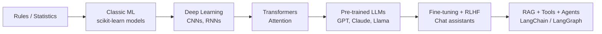

# AI / ML / GenAI Primer - for readers new to AI

This guide explains, in plain English, the concepts behind **Movie Recommendation System using R (Item-Based Collaborative Filtering)** and how they lead to modern Generative AI (LLMs, RAG, agents). No prior AI knowledge is assumed.

## 1. Classic Machine Learning in 2 minutes

| Term | Plain-English meaning |
|---|---|
| **Artificial Intelligence (AI)** | Any technique that lets a computer do something we would normally call 'smart' - recognise a face, understand a sentence, recommend a movie. |
| **Machine Learning (ML)** | A branch of AI where the computer learns patterns from examples (data) instead of being given hand-written rules. |
| **Deep Learning (DL)** | ML using neural networks with many layers. Powers image recognition, speech and today's large language models. |
| **Dataset** | The table (or folder of images / text) the model learns from. Each row is one example. |
| **Feature** | One input column the model looks at, e.g. humidity, word counts, pixel values. |
| **Label / Target** | The answer we want the model to predict, e.g. 'Will it rain tomorrow? Yes/No'. |
| **Training** | Showing the model many examples with known answers so it can adjust its internal numbers (parameters). |
| **Testing / Evaluation** | Checking the trained model on examples it has never seen to measure how good it really is. |
| **Classification** | Predicting a category (rain / no rain, attack / normal, dog / lion). |
| **Regression** | Predicting a number (how many days late an invoice will be paid). |
| **Overfitting** | The model memorises the training data and fails on new data - like a student who memorised answers instead of learning the subject. |
| **Accuracy, Precision, Recall, F1** | Scorecards. Accuracy = % correct overall. Precision = when the model says 'yes', how often it is right. Recall = of all real 'yes' cases, how many it caught. F1 balances the two. |
| **Confusion Matrix** | A 2x2 (or NxN) table showing correct vs wrong predictions for each class. |
| **Recommender system** | Software that suggests items (movies, products, songs) a user is likely to enjoy. |
| **Collaborative filtering** | Recommending based on the behaviour of similar users or items, not on item content. |
| **Item-based CF (IBCF)** | Find movies similar to ones the user liked, based on co-rating patterns. |
| **Cosine similarity** | Similarity of two vectors measured by the angle between them; 1 = same direction, 0 = unrelated. |
| **Sparsity** | Share of empty cells - most users have rated only a tiny fraction of movies. |
| **Cold start** | New users or movies with no ratings cannot be handled by pure collaborative filtering. |

## 2. From classic ML to Generative AI

This project sits at the **Classic ML (unsupervised similarity / collaborative filtering) - the conceptual ancestor of embeddings and vector search** stage of that journey.

## 3. GenAI skills explained

### GPT architecture & attention

GPT (Generative Pre-trained Transformer) is a neural network that reads text as tokens (word pieces) and predicts the next token. Its key ingredient is **self-attention**: for every word it computes how much every other word in the sentence matters (Query x Key -> weights -> weighted sum of Values). Stacking dozens of attention + feed-forward layers lets it model grammar, facts and reasoning.

### Pre-training vs. fine-tuning

**Pre-training**: the model reads trillions of tokens from the internet to learn general language (expensive, done once by OpenAI, Anthropic, Meta...). **Fine-tuning**: you take that pre-trained model and train it a little more on your own, smaller, labelled dataset so it specialises (e.g. legal summaries, customer-support tone). Same idea as training a classic ML model, but starting from a very smart base.

### RLHF (Reinforcement Learning from Human Feedback)

After pre-training, humans rank several model answers from best to worst. A *reward model* learns those preferences, and the LLM is then optimised (e.g. with PPO or DPO) to produce answers humans prefer - more helpful, honest and harmless. This is what turns a raw text predictor into a chat assistant.

### Hallucination

When an LLM confidently produces something false (fake citations, wrong numbers). It happens because the model predicts *plausible* text, not *verified* text. Mitigations: RAG (ground answers in real documents), asking for sources, lower temperature, evaluations and human review.

### Context window

The maximum amount of text (measured in tokens) an LLM can 'see' at once - prompt + documents + its own answer. Ranges from ~8K to 1M+ tokens. Anything outside the window is invisible to the model, which is why we chunk documents and retrieve only the relevant pieces.

### RAG (Retrieval-Augmented Generation)

Instead of hoping the model memorised your data, you **retrieve** the most relevant documents at question time and paste them into the prompt, then the LLM **generates** an answer grounded in them. Pipeline: chunk documents -> embed -> store in a vector DB -> embed the question -> similarity search -> prompt LLM with top-k chunks.

### Embeddings & vector databases

An **embedding** is a list of numbers (a vector) that captures meaning - similar sentences get vectors that are close together. A **vector database** (FAISS, Chroma, Pinecone, pgvector, Weaviate) stores millions of these vectors and finds the nearest ones fast using cosine similarity. This is the evolution of the TF-IDF vectors and cosine-similarity matrices used in classic ML projects.

### LangChain / LangGraph

**LangChain** is a Python/JS framework with building blocks for LLM apps: prompt templates, model wrappers, document loaders, retrievers, output parsers and tool calling. **LangGraph** (built on LangChain) models an application as a *graph of steps with state*, which makes multi-step, looping, human-in-the-loop **AI agents** reliable.

### Prompt engineering

Designing the instructions you give an LLM: role, task, context, constraints, examples (few-shot), output format (JSON schema) and step-by-step reasoning cues. Good prompts are versioned and evaluated like code.

### Fine-tuning vs. prompting vs. RAG

**Prompting**: cheapest and fastest - change the instructions. Use first. **RAG**: when the model needs *your* up-to-date or private knowledge; easy to update by re-indexing documents. **Fine-tuning**: when you need a consistent style/format/behaviour or a smaller cheaper model for a narrow task and you have quality labelled examples. They are often combined.

### AI Automation & Integration

Embedding ML/LLM models inside business workflows - APIs, schedulers, CRMs, ERPs, ticketing tools - so predictions trigger real actions (e.g. flag a risky invoice, open a security ticket, send a weather alert). Tools: REST/FastAPI, webhooks, n8n/Zapier/Power Automate, cloud functions.

### GenAI (Generative AI)

Models that *create* new content - text (GPT, Claude, Llama), images (Stable Diffusion, DALL-E), audio, code - rather than only classifying or predicting a number.

### AI Agents

An LLM that can **plan**, **call tools** (search, database, Python, APIs), **observe results** and **loop** until a goal is met. Example: an agent that reads a security log, queries a threat database, and drafts an incident report.

### AI Tools

The everyday toolbox: OpenAI / Anthropic / Gemini APIs, Hugging Face, Ollama (local models), LangChain, LlamaIndex, vector DBs, Cursor/Copilot, Streamlit/Gradio for quick UIs, MLflow/W&B for experiment tracking.

### Python

The main language of AI/ML. Key libraries: NumPy, pandas (data), scikit-learn (classic ML), TensorFlow/Keras & PyTorch (deep learning), NLTK/spaCy/Transformers (text), Streamlit/FastAPI (apps), LangChain (LLM apps).

## 4. How *Movie Recommendation System using R (Item-Based Collaborative Filtering)* connects to these GenAI skills

| GenAI skill | Connection to this project |
|---|---|
| **Embeddings & vector DBs** | Each movie's rating column is a hand-made embedding; matrix factorisation / two-tower models learn dense embeddings, stored in FAISS/Pinecone for millisecond nearest-neighbour lookup. |
| **RAG** | Cosine top-k over item vectors = the 'retrieve' step of RAG. A conversational recommender retrieves candidate movies, then an LLM explains and personalises the list. |
| **Prompt engineering** | Prompt an LLM with the user's top-rated films + 10 IBCF candidates: 'Rank and explain these for a user who loves sci-fi thrillers' (re-ranking). |
| **Hallucination** | LLMs alone may invent movies or plots; grounding recommendations in the real catalogue and IBCF candidates prevents fake titles. |
| **Context window** | A full 668 x 10,325 matrix cannot fit in a prompt - retrieval (IBCF / vector search) selects the few relevant movies the LLM needs. |
| **AI Agents** | A movie-night agent: reads your watch history, calls the recommender tool, checks streaming availability via API, and books tickets. |
| **Fine-tuning vs prompting vs RAG** | Use CF/embeddings for scalable candidate retrieval, prompting for explanation, and fine-tuning only for a house recommendation style. |
| **LangChain / LangGraph** | LangChain retriever over a movie vector store + LLM chain for natural-language recommendations. |

## 5. Future AI projects you can build from here

1. **Conversational movie recommender (RAG)** - embed plot summaries + IBCF signals, store in Chroma, let an LLM answer 'something like Inception but lighter'.
2. **Hybrid recommender** - combine IBCF with content embeddings of genres/plots to solve the cold-start problem for new movies.
3. **LLM re-ranker** - generate candidates with IBCF, then let an LLM re-rank and write one-line explanations.
4. **Python port with implicit/LightFM + FastAPI** - serve recommendations as an API that an AI agent can call.
