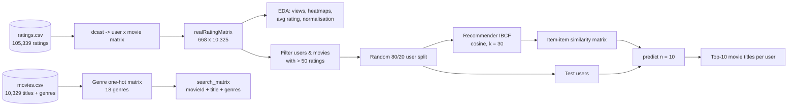
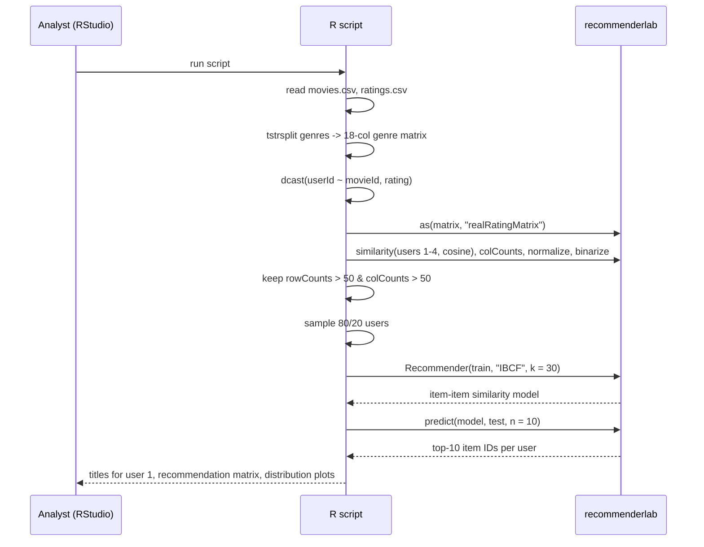
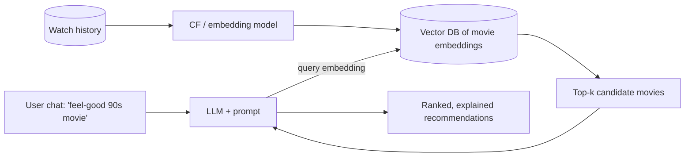

# Architecture - Movie Recommendation System using R (Item-Based Collaborative Filtering)

> **Docs:** [README](../README.md) | [Architecture](ARCHITECTURE.md) | [HLD](HLD.md) | [LLD](LLD.md) | [Model Details](MODEL_DETAILS.md) | [AI Primer](AI_ML_GENAI_PRIMER.md) | [Presentation](presentation/Movie_Recommendation_System_R.pptx)

## 1. System context

A single R script that loads MovieLens CSVs, builds a sparse rating matrix, explores it visually, trains an item-based collaborative filtering model on active users / popular movies, and generates top-10 recommendations for held-out users.

## 2. Architecture diagram

## 3. Layered view

| Layer | Responsibility | Implementation |
|---|---|---|
| Data layer | Movie catalogue and ratings | `movies.csv`, `ratings.csv` |
| Transformation layer | Genre one-hot matrix; ratings pivot to user x movie | data.table `tstrsplit`, reshape2 `dcast` |
| Matrix layer | Sparse `realRatingMatrix` | recommenderlab |
| Analysis layer | View counts, heatmaps, average ratings, normalisation, binarisation | ggplot2, `image()` |
| Model layer | IBCF with cosine similarity, k = 30 | recommenderlab `Recommender` |
| Recommendation layer | Top-10 per user, map IDs to titles, item frequency | `predict`, base R |

## 4. End-to-end data flow

## 5. Deployment view

Runs locally in R/RStudio; all data fits in memory. For serving, the model could be wrapped with `plumber` (R REST API) or ported to Python.

## 6. Target (production / GenAI-ready) architecture

A modern, GenAI-enabled recommender built on the same ideas:

