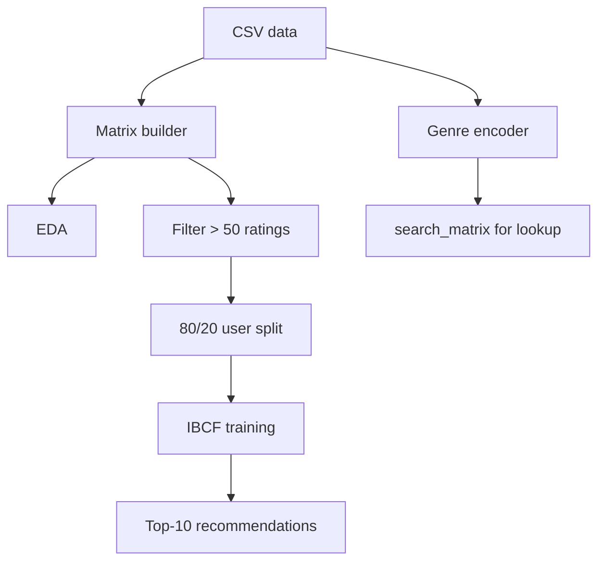

# High-Level Design (HLD) - Movie Recommendation System using R (Item-Based Collaborative Filtering)

> **Docs:** [README](../README.md) | [Architecture](ARCHITECTURE.md) | [HLD](HLD.md) | [LLD](LLD.md) | [Model Details](MODEL_DETAILS.md) | [AI Primer](AI_ML_GENAI_PRIMER.md) | [Presentation](presentation/Movie_Recommendation_System_R.pptx)

## 1. Purpose

Generate personalised top-10 movie recommendations from historical user ratings using item-based collaborative filtering.

## 2. Goals
- Build a sparse user x movie rating matrix.
- Understand rating behaviour through visual EDA.
- Train an IBCF model and produce top-10 recommendations per user.

## 3. Scope

**In scope**

- Explicit ratings (0.5-5)
- Item-based CF with cosine similarity
- Visual analysis in R

**Out of scope**

- Content-based or hybrid filtering
- Real-time serving
- Cold-start handling
- Offline evaluation metrics

## 4. Major components

| Component | Responsibility | Technology |
|---|---|---|
| Data Loader | Read movies and ratings CSVs | base R |
| Genre Encoder | Pipe-split genres -> 18-col binary matrix | data.table |
| Matrix Builder | Pivot ratings; convert to realRatingMatrix | reshape2, recommenderlab |
| EDA & Visualisation | Views, heatmaps, distributions, normalisation | ggplot2, image() |
| Data Filter | Active users & popular movies (> 50 ratings) | recommenderlab rowCounts/colCounts |
| IBCF Model | Item-item cosine similarity, top-30 neighbours | recommenderlab |
| Recommender | Top-10 per user, ID -> title mapping | predict, base R |

## 5. High-level pipeline

| Stage | What happens |
|---|---|
| 1. Load | Read `movies.csv` (10,329) and `ratings.csv` (105,339). |
| 2. Genre matrix | Split genres on `\|`, one-hot into 18 genre columns; combine with movieId and title as `search_matrix`. |
| 3. Rating matrix | `dcast(userId ~ movieId, value.var='rating')` -> 668 x 10,325 -> `realRatingMatrix`. |
| 4. Explore | Available recommenders & IBCF parameters; cosine similarity of first 4 users; unique ratings table. |
| 5. Popularity | `colCounts` = views per movie; top-6 bar chart. |
| 6. Heatmaps | First 20x20 ratings; top 2% users x movies. |
| 7. Filter | Keep users and movies with > 50 ratings. |
| 8. Distributions | Average rating per user; normalised ratings; binarised 'good' ratings (>= 3). |
| 9. Split | Random ~80/20 split of users. |
| 10. Train | `Recommender(training_data, method='IBCF', parameter=list(k=30))`. |
| 11. Inspect | Similarity matrix heatmap; distribution of non-zero similarities per item. |
| 12. Recommend | `predict(n=10)`; titles for user 1; recommendation matrix; most-recommended movies. |

## 6. Data design (high level)

Central structure: a sparse `realRatingMatrix` (users = rows, movies = columns, NA = unrated). The IBCF model stores an item x item similarity matrix in which each row keeps only its k = 30 largest cosine similarities.

## 7. Non-functional requirements

| Attribute | How it is addressed |
|---|---|
| Scalability | Sparse matrices keep 105K ratings in memory easily; IBCF similarity is pre-computed once. |
| Latency | Prediction = weighted sum over 30 neighbours - fast per user. |
| Explainability | 'Recommended because you liked X' falls out of item neighbours. |
| Reproducibility | Add `set.seed()` before `sample()` for a fixed split. |

## 8. Key design decisions

| Decision | Rationale |
|---|---|
| Item-based rather than user-based CF | Item similarities are more stable over time and cheaper to pre-compute. |
| Cosine similarity | Works well on sparse rating vectors; recommenderlab default. |
| k = 30 | Keeps strong neighbours only, reduces noise and memory. |
| Filter > 50 ratings | Reduces sparsity, gives reliable similarities. |

## 9. Risks & mitigations

| Risk | Mitigation |
|---|---|
| Popularity bias | Add diversity/novelty re-ranking; include long-tail items. |
| Cold start | Hybrid with genre/plot embeddings. |
| Hard-coded Windows paths | Use relative paths / `here` package. |
| Inefficient genre loop (`1:nrow` used for columns) | Use `1:ncol(movie_genre2)` or a vectorised approach. |
