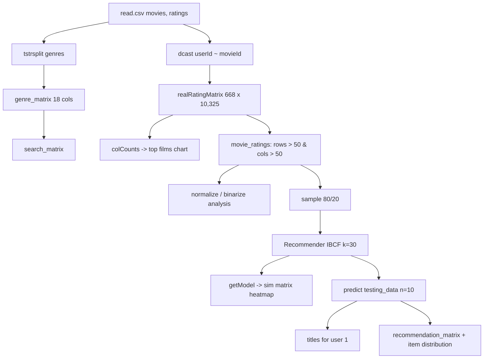

# Low-Level Design (LLD) - Movie Recommendation System using R (Item-Based Collaborative Filtering)

> **Docs:** [README](../README.md) | [Architecture](ARCHITECTURE.md) | [HLD](HLD.md) | [LLD](LLD.md) | [Model Details](MODEL_DETAILS.md) | [AI Primer](AI_ML_GENAI_PRIMER.md) | [Presentation](presentation/Movie_Recommendation_System_R.pptx)

## 1. Module / notebook breakdown

| Module | Responsibility |
|---|---|
| Setup | `setwd`, `library(recommenderlab, data.table, reshape2, ggplot2)` |
| Load & summarise | `read.csv`, `str`, `summary` |
| Genre matrix | `tstrsplit(genres, '[\|]')` -> `genre_matrix1` (10,330 x 18) -> integer `genre_matrix2` |
| Search matrix | `cbind(movies_df[,1:2], genre_matrix2)` |
| Rating matrix | `dcast` -> `as.matrix` -> `as(..., 'realRatingMatrix')` |
| Model registry | `recommenderRegistry$get_entries(dataType='realRatingMatrix')` |
| Similarity & EDA | `similarity(..., method='cosine', which='users')`, `colCounts`, ggplot bar chart, `image()` heatmaps |
| Filtering & normalisation | `rowCounts > 50`, `colCounts > 50`, `quantile(..., 0.98)`, `normalize`, `binarize(minRating=3)` |
| Training | `sample(c(TRUE, FALSE), prob=c(0.8, 0.2))`, `Recommender(method='IBCF', parameter=list(k=30))` |
| Recommendation | `predict(n=10)`, map `itemLabels` to titles, `sapply` recommendation matrix, frequency table |

## 2. Input data schema

| Field | Type | Description |
|---|---|---|
| movies.movieId | int | Movie identifier |
| movies.title | string | Title with year |
| movies.genres | string | Pipe-separated genres |
| ratings.userId | int | User identifier (668 users) |
| ratings.movieId | int | Movie identifier |
| ratings.rating | float 0.5-5 | Star rating |
| ratings.timestamp | int (Unix) | When the rating was given (not used) |

## 3. Detailed processing flow



### 3.1 Rating matrix construction

```r
rating_matrix <- dcast(ratings_df, ratings_df$userId ~ ratings_df$movieId,
                       value.var = "rating", na.rm = FALSE)
rating_matrix <- as.matrix(rating_matrix[, -1])          # drop userId column
rating_matrix <- as(rating_matrix, "realRatingMatrix")   # sparse 668 x 10,325
```

### 3.2 Filtering active users and popular movies

```r
movie_ratings <- rating_matrix[rowCounts(rating_matrix) > 50,
                               colCounts(rating_matrix) > 50]
```
Keeps roughly 420 users and 447 movies - a much denser matrix for reliable similarities.

### 3.3 IBCF training

```r
sampled_data  <- sample(x = c(TRUE, FALSE), size = nrow(movie_ratings),
                        replace = TRUE, prob = c(0.8, 0.2))
training_data <- movie_ratings[sampled_data, ]
testing_data  <- movie_ratings[!sampled_data, ]
recomm_model  <- Recommender(data = training_data, method = "IBCF",
                             parameter = list(k = 30))
```
recommenderlab's IBCF defaults: `method = "Cosine"`, `normalize = "center"` (subtract each user's mean rating), `alpha = 0.5`, `na_as_zero = FALSE`.

### 3.4 Prediction

For a user `u` and an unseen movie `i`, the predicted score is the similarity-weighted average of the user's ratings on `i`'s neighbours:

`score(u, i) = sum_j sim(i, j) * r(u, j) / sum_j |sim(i, j)|`, over the k = 30 neighbours `j` of `i` that `u` has rated.

```r
predicted_recommendations <- predict(object = recomm_model, newdata = testing_data, n = 10)
```

## 4. Key functions / interfaces

| Function / Object | Input | Output | Notes |
|---|---|---|---|
| `tstrsplit(x, '[\|]')` | genre strings | list of columns | data.table |
| `dcast(df, userId ~ movieId, value.var='rating')` | long ratings | wide matrix | reshape2 |
| `similarity(x, method='cosine', which='users')` | rating matrix | dist object | Explore user similarity |
| `normalize(x)` / `binarize(x, minRating=3)` | realRatingMatrix | normalised / binary matrix | EDA |
| `Recommender(data, method='IBCF', parameter=list(k=30))` | training matrix | model | Item similarity |
| `getModel(model)$sim` | model | item x item similarity | Inspection |
| `predict(model, newdata, n=10)` | test users | topNList | Top-10 per user |

## 5. Configuration & hyper-parameters

| Parameter | Value | Where / why |
|---|---|---|
| Activity threshold | > 50 ratings (users and movies) | Denser matrix |
| Heatmap quantile | 0.98 (top 2%) / 0.95 | Visualise most active users/movies |
| Binarise threshold | minRating = 3 | 'Good' ratings |
| Train/test | prob = c(0.8, 0.2) | Random user split |
| IBCF k | 30 | Neighbours kept per item |
| Top-N | 10 | Recommendations per user |

## 6. Error handling & edge cases

- Users with no ratings on any neighbour items receive fewer than 10 recommendations.
- Movies not in the filtered set (<= 50 ratings) are never recommended (long-tail gap).
- The genre-matrix inner loop iterates `1:nrow` instead of `1:ncol`, making it very slow - fix before re-running on large data.
- Hard-coded `C:/Users/...` paths must be changed on other machines.
